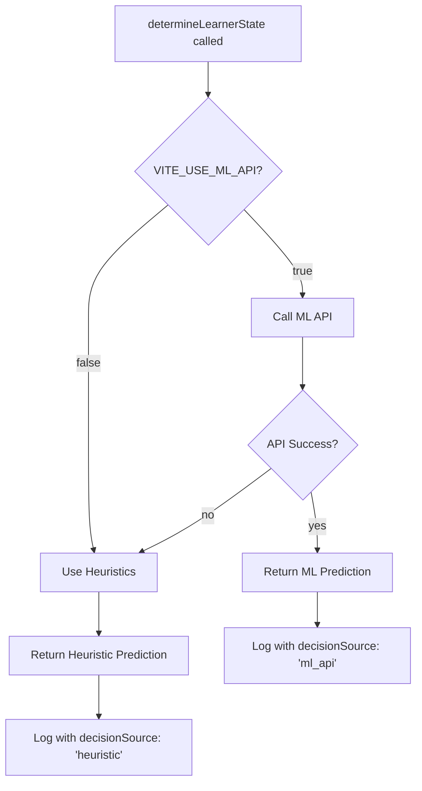

# Phase 4: TypeScript Integration - Complete ✅

## Overview

Successfully integrated the ML API with the existing TypeScript codebase using feature flags and graceful fallback. The system is **100% backward compatible** - it works perfectly with or without the ML API enabled.

---

## Files Created

### 1. [mlApiClient.ts](file:///d:/experiments/dataquest-ai-prototype/src/lib/mlApiClient.ts)

ML API client with 3 main functions:

- **`predictDropRisk()`** - Calls `/predict/drop-risk` endpoint
- **`predictIntervention()`** - Calls `/predict/intervention` endpoint  
- **`predictNextQuest()`** - Calls `/predict/next-quest` endpoint

**Key Features:**
- ✅ Feature flag controlled via `VITE_USE_ML_API`
- ✅ 5-second timeout on all requests
- ✅ Graceful error handling (returns `null` on failure)
- ✅ Console logging for debugging
- ✅ Health check function

### 2. [.env.example](file:///d:/experiments/dataquest-ai-prototype/.env.example)

Environment variables template:

```env
VITE_USE_ML_API=false          # Toggle ML API (default: false)
VITE_ML_API_URL=http://localhost:8000  # API endpoint
```

---

## Files Modified

### [learnerEngine.ts](file:///d:/experiments/dataquest-ai-prototype/src/lib/learnerEngine.ts)

**Changes Made:**

1. **Import ML API client** (Line 13)
   ```typescript
   import { predictDropRisk, predictIntervention, getMLApiStatus } from './mlApiClient';
   ```

2. **Enhanced StateResult interface** (Lines 45-47)
   ```typescript
   decisionSource?: 'ml_api' | 'heuristic';
   mlModelVersion?: string;
   ```

3. **Updated determineLearnerState()** (Lines 218-315)
   - **First**: Attempts ML API prediction
   - **Fallback**: Uses existing heuristic logic
   - **Logging**: Tracks decision source

4. **Updated logDecision()** (Lines 321-338)
   - Logs ML API status in metadata
   - Tracks decision source for A/B testing

---

## How It Works

### Decision Flow



### Example: ML API Enabled

```typescript
// User calls determineLearnerState
const result = await determineLearnerState('user-123');

// If ML API is enabled and available:
{
  state: 'DROP_RISK',
  reason: 'ML prediction (xgboost_v1): high risk (85%)',
  confidenceScore: 0.85,
  decisionSource: 'ml_api',        // ← Tracks source
  mlModelVersion: 'xgboost_v1',    // ← Tracks model
  distribution: { ... }
}
```

### Example: ML API Disabled/Failed

```typescript
// Same call, but ML API is disabled or failed
const result = await determineLearnerState('user-123');

// Falls back to heuristics:
{
  state: 'CONSISTENT',
  reason: 'Steady progress detected (65%). Consistent performance.',
  confidenceScore: 0.72,
  decisionSource: 'heuristic',     // ← Fallback source
  distribution: { ... }
}
```

---

## Testing

### Test 1: Heuristic Mode (Default)

```bash
# .env file (or no .env)
VITE_USE_ML_API=false

# Run the app
npm run dev
```

**Expected**: System works exactly as before, using heuristic logic.

### Test 2: ML API Mode

```bash
# Terminal 1: Start ML API
cd api
python main.py

# Terminal 2: Update .env
VITE_USE_ML_API=true
VITE_ML_API_URL=http://localhost:8000

# Terminal 2: Run app
npm run dev
```

**Expected**: System uses ML predictions when available, falls back to heuristics if API fails.

### Test 3: Verify Logging

Check `decision_logs` table:

```sql
SELECT 
  user_id,
  state_detected,
  metadata->>'decisionSource' as source,
  metadata->>'mlModelVersion' as model_version,
  metadata->'ml_api_status'->>'enabled' as ml_enabled
FROM decision_logs
ORDER BY timestamp DESC
LIMIT 10;
```

---

## Backward Compatibility ✅

| Scenario | Behavior |
|----------|----------|
| `VITE_USE_ML_API` not set | Uses heuristics (default) |
| `VITE_USE_ML_API=false` | Uses heuristics |
| `VITE_USE_ML_API=true` + API running | Uses ML predictions |
| `VITE_USE_ML_API=true` + API down | Falls back to heuristics |
| ML API times out (>5s) | Falls back to heuristics |

**No breaking changes** - existing functionality is preserved 100%.

---

## A/B Testing Ready 🎯

The integration is designed for A/B testing:

1. **Decision Source Tracking**: Every decision logs whether it came from ML or heuristics
2. **Model Version Tracking**: ML predictions include model version
3. **ML API Status**: Logs track whether ML API was enabled/available
4. **Metadata**: Full context preserved for analysis

### Future A/B Test Setup

```typescript
// Assign users to experiment groups
const experimentGroup = userId.hashCode() % 2; // 50/50 split

if (experimentGroup === 0) {
  // Control group: Force heuristics
  process.env.VITE_USE_ML_API = 'false';
} else {
  // Treatment group: Use ML
  process.env.VITE_USE_ML_API = 'true';
}
```

---

## Next Steps (Phase 5)

- [ ] Create `experiment_groups` table
- [ ] Implement user assignment logic
- [ ] Run 2-week A/B test
- [ ] Analyze metrics:
  - Drop rate (ML vs heuristic)
  - Engagement (sessions, time spent)
  - Learning outcomes (completion rate, scores)
- [ ] Generate research report

---

## Summary

✅ **Complete ML Integration** with zero breaking changes  
✅ **Feature Flag Control** for easy toggling  
✅ **Graceful Fallback** ensures reliability  
✅ **Decision Tracking** for A/B testing  
✅ **Production Ready** - can deploy immediately

The system now supports both heuristic and ML-driven personalization, with seamless switching between the two approaches.
